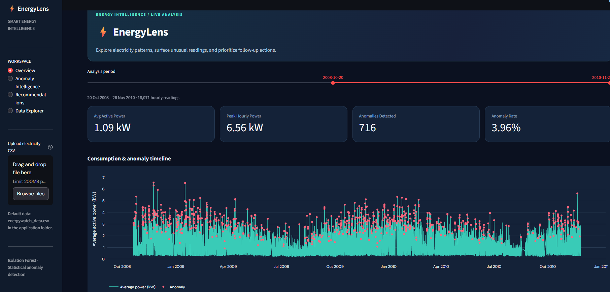

# ⚡ EnergyWatch AI
### Smart Electricity Monitoring & Anomaly Detection

**EnergyWatch AI** is a machine learning-powered electricity analytics dashboard that detects unusual household power consumption patterns, prioritizes anomalies, and generates actionable energy-monitoring recommendations. Built with **Python, Isolation Forest, Streamlit, and Plotly**.

## 📸 Dashboard Preview

### 1. Electricity Consumption Overview
Track average and peak power, anomaly counts, daily consumption trends, and hourly usage patterns.



### 2. Anomaly Intelligence
Explore statistical risk distribution, anomalies by hour of day, and the highest-scoring unusual readings.


### 3. Smart Energy Recommendations
Review prioritized energy observations, filter by risk, and identify high-power, overnight, and high-current usage patterns.


## ✨ Key Features

- **Interactive monitoring:** Average power, peak hourly power, anomaly count, and anomaly rate.
- **Consumption analytics:** Time-series charts, daily average power, and usage by hour.
- **ML anomaly detection:** Isolation Forest flags statistically unusual hourly readings.
- **Risk prioritization:** Low, Medium, and High levels based on model anomaly scores.
- **Smart recommendations:** Rule-based suggestions for high consumption, high current, and elevated overnight usage.
- **CSV analysis:** Upload electricity readings, inspect results, and export analyzed data.
- **Dark-themed dashboard:** Four views — Overview, Anomaly Intelligence, Recommendations, and Data Explorer.

## 🧠 Model & Evaluation

| Metric | Result |
|---|---:|
| Machine learning algorithm | Isolation Forest |
| Original cleaned minute-level records | 2,049,280 |
| Hourly observations | 34,168 |
| Normal observations | 32,459 |
| Flagged anomalies | 1,709 |
| Anomaly rate | 5.00% |
| Silhouette Score | **0.5853** |
| Contamination setting | 0.05 |

The **Silhouette Score** measures separation between predicted normal and anomalous groups; it is **not model accuracy**. Accuracy, precision, recall, and F1-score cannot be established without verified ground-truth anomaly labels. Flagged anomalies do not confirm equipment faults or electricity theft.

## 📊 Dataset

**Source:** [UCI Machine Learning Repository — Individual Household Electric Power Consumption](https://archive.ics.uci.edu/dataset/235/individual+household+electric+power+consumption)

- Real measurements from a single household in **France**, collected between **December 2006 and November 2010**.
- Original observations are approximately minute-level; the project uses **hourly mean measurements** for model training.
- Model inputs: `Global_active_power`, `Global_reactive_power`, `Voltage`, `Global_intensity`, `Sub_metering_1`, `Sub_metering_2`, `Sub_metering_3`.
- `Global_active_power` is expressed in **kW** (power), not **kWh** (energy).

## 🛠️ Tech Stack

**Python · Pandas · Scikit-learn · Isolation Forest · Streamlit · Plotly · Joblib**

## 📁 Project Structure

```text
EnergyWatch-AI/
├── app.py
├── requirements.txt
├── start_windows.bat
├── README.md
├── screenshots/
│   ├── D1.png
│   ├── D2.png
│   └── D3.png
├── energywatch_model.pkl       # Add from Google Colab
└── energywatch_data.csv        # Add from Google Colab
```

## 🚀 Run Locally

1. Clone or download this repository.
2. Place `energywatch_model.pkl` and `energywatch_data.csv` (exported from the training notebook) alongside `app.py`.
3. Install dependencies and start Streamlit:

```bash
python -m pip install -r requirements.txt
python -m streamlit run app.py
```

The dashboard opens in your browser. You can also run `start_windows.bat` on Windows.

### Uploading your own data

Upload a CSV with `Datetime` (or separate `Date` and `Time`) and the seven model input columns listed above. New data must be comparable to the training measurements; the app can aggregate minute-level readings to hourly means. The trained `.pkl` model is required for new predictions.

## ⚠️ Limitations

- This is **unsupervised statistical anomaly detection**, not verified fault detection.
- The approximately 5% anomaly rate is influenced by the configured contamination parameter.
- Recommendation thresholds are illustrative and should be calibrated for other households or meters.
- Data comes from one household in France; performance on other locations or electricity systems is not established.

---

*Built as an end-to-end machine learning and analytics portfolio project.*
