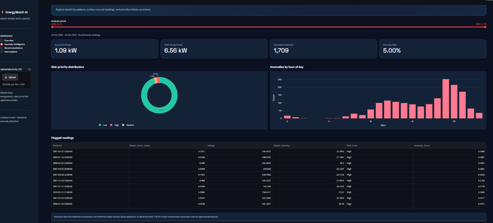
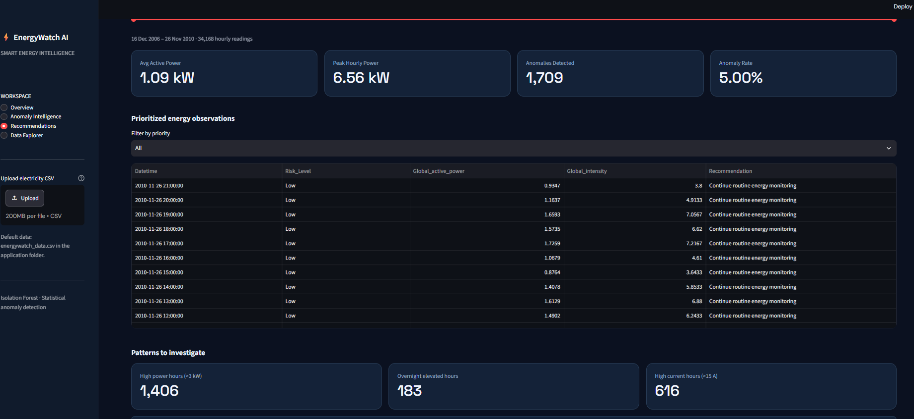

# ⚡ EnergyLens
### Electricity Consumption Analytics & Anomaly Detection

**EnergyLens** is a machine learning-powered electricity analytics dashboard that detects unusual household power consumption patterns, prioritizes anomalies, and generates actionable energy-monitoring recommendations.

Built with **Python, Isolation Forest, Streamlit, and Plotly**.

---

## 📸 Dashboard Preview

### 1. Electricity Consumption Overview

Track average and peak power, anomaly counts, daily consumption trends, and hourly usage patterns.


### 2. Anomaly Intelligence

Explore statistical risk distribution, anomalies by hour of day, and the highest-scoring unusual readings.



### 3. Smart Energy Recommendations

Review prioritized energy observations, filter by risk, and identify high-power, overnight, and high-current usage patterns.



---

## ✨ Key Features

- **Interactive Monitoring:** Average power, peak hourly power, anomaly count, and anomaly rate.
- **Consumption Analytics:** Time-series charts, daily average power, and usage by hour.
- **ML Anomaly Detection:** Isolation Forest flags statistically unusual hourly readings.
- **Risk Prioritization:** Low, Medium, and High levels based on model anomaly scores.
- **Smart Recommendations:** Rule-based suggestions for high consumption, high current, and elevated overnight usage.
- **CSV Analysis:** Upload electricity readings, inspect results, and export analyzed data.
- **Interactive Dashboard:** Four views — Overview, Anomaly Intelligence, Recommendations, and Data Explorer.

---

## 🧠 Model & Evaluation

| Metric | Result |
|---|---:|
| Machine Learning Algorithm | Isolation Forest |
| Original Cleaned Minute-Level Records | 2,049,280 |
| Hourly Observations | 34,168 |
| Normal Observations | 32,459 |
| Flagged Anomalies | 1,709 |
| Anomaly Rate | 5.00% |
| Silhouette Score | **0.5853** |
| Contamination Setting | 0.05 |

**Evaluation Note:**

The Silhouette Score measures separation between predicted normal and anomalous groups. It is **not model accuracy**.

Accuracy, precision, recall, and F1-score cannot be established without verified ground-truth anomaly labels.

Flagged anomalies do not confirm equipment faults or electricity theft.

---

## 📊 Dataset

**Source:** [UCI Machine Learning Repository — Individual Household Electric Power Consumption](https://archive.ics.uci.edu/dataset/235/individual+household+electric+power+consumption)

- Real electricity measurements from a single household in **France**.
- Data collected between **December 2006 and November 2010**.
- Original observations are approximately minute-level.
- The project uses **hourly mean measurements** for model training.

### Model Input Features

1. `Global_active_power`
2. `Global_reactive_power`
3. `Voltage`
4. `Global_intensity`
5. `Sub_metering_1`
6. `Sub_metering_2`
7. `Sub_metering_3`

**Note:** Global active power is measured in kW, not kWh.

---

## 🛠️ Tech Stack

| Category | Technologies |
|---|---|
| Programming | Python |
| Data Processing | Pandas, NumPy |
| Machine Learning | Scikit-learn, Isolation Forest |
| Data Visualization | Plotly |
| Application Development | Streamlit |
| Model Serialization | Joblib |

---

## 📁 Project Structure

```text
EnergyLens/
│
├── app.py
├── requirements.txt
├── start_windows.bat
├── README.md
│
├── D1.png
├── D2.png
├── D3.png
│
├── EnergyCons.ipynb
│
├── energywatch_model.pkl
└── energywatch_data.csv
```

**Note:** The existing model and dataset filenames are retained for compatibility with the application.

---

## 🚀 Run Locally

### Step 1 — Clone the Repository

```bash
git clone https://github.com/namrataamali/EnergyLens.git
cd EnergyLens
```

### Step 2 — Install Dependencies

```bash
python -m pip install -r requirements.txt
```

### Step 3 — Add Model and Dataset Files

Ensure these files are available in the project directory:

```text
energywatch_model.pkl
energywatch_data.csv
```

These files are exported from the training notebook.

### Step 4 — Launch the Application

```bash
python -m streamlit run app.py
```

The Streamlit dashboard will open in your browser.

Windows users can also launch the application using:

```text
start_windows.bat
```

---

## 📤 Uploading Your Own Data

EnergyLens supports uploading electricity consumption records in CSV format.

The uploaded dataset should contain:

- `Datetime` or separate `Date` and `Time` columns.
- The seven model input features listed above.

The application can aggregate minute-level readings into hourly averages.

**Important:** New data should be comparable to the training measurements. The trained `.pkl` model is required for predictions.

---

## ⚠️ Limitations

- This project performs **unsupervised statistical anomaly detection**, not verified fault detection.
- The approximately 5% anomaly rate is influenced by the configured contamination parameter.
- Recommendation thresholds are illustrative and may require calibration for other households.
- The dataset represents one household in France.
- Model performance on other electricity systems or geographical locations has not been established.

---

## 🎯 Project Objective

EnergyLens demonstrates how machine learning and interactive analytics can be combined to explore electricity consumption patterns, identify unusual observations, and support data-driven energy monitoring.

---

*Developed as an end-to-end Data Analytics and Machine Learning portfolio project.*
